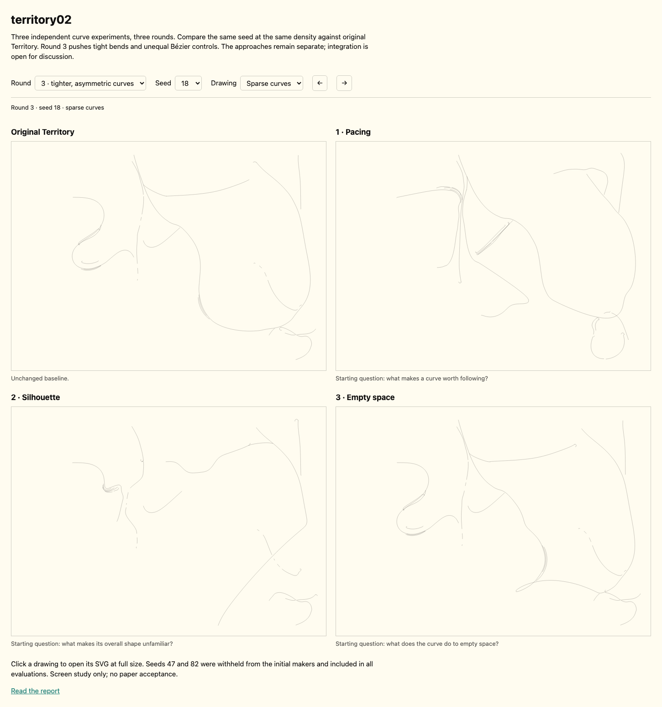

# territory02 — independent curve studies

5 October 2026. Three rounds of three independent Sol experiments, with separate
Sol evaluations. Convergence and production integration are deliberately deferred
until Ian has inspected the results and offered a direction.

Unequal Bézier controls produced clearer departures than the restrained second
round, but tighter geometry did not reliably produce more interesting drawings.
The most useful material includes abrupt returns, long off-axis passages and
earlier awkward constructions that later rounds lost. Full-density growth still
often covers those distinctions with familiar banks and fans. This is a set of
alternatives to inspect, rather than a single best version of Territory.

[Open the visual comparison](../../tools/territory02/index.html). It puts original
Territory and all three experiments beside each other at the same seed, density
and round. Click a drawing for its full SVG. Start with sparse curves, then switch
to full density; return to rounds 1 and 2 to see both gains and losses.

## Brief and evidence

Ian wanted curves that change character along their course and have stranger
overall shapes. The makers shared that brief, with loose starting questions:
**1 — pacing**, what makes a curve worth following; **2 — silhouette**, what makes
its overall shape unfamiliar; **3 — empty space**, what a curve does to a void.
These were starting questions, not compulsory motifs or three prescribed styles.

All three used the existing Territory Version 10 engine in isolated prototype
copies. Six common seeds are shown under two fixed recipes: sparse (density 0)
and full (density 1, cover 0.45, grown fields). Seeds 5, 13, 18 and 24 were the
initial development population; 47 and 82 were withheld from the first makers,
then disclosed through the first critique and available in round 2. They are
not fresh holdouts for the second round. Both recipes retain the same other
drawing dials and input cores. Quiet, weak and nearly promising cases remain.

During round 1 Ian requested thinner strokes. All current comparisons use
**0.1 mm**, down from the initial 0.3 mm. This changes presentation, not bundle
geometry, spacing or the stored paths. The first reviewer re-examined the same
geometry after thinning; its reassessment materially softened the earlier
saturation criticism. Small thumbnails can make these fine lines pale; SVGs
and close views are better evidence for continuity than thumbnail darkness.

The makers were **gpt-6.1-sol**; the three independent reviewers were fresh
**gpt-5.6-sol** agents, following the drawing-review skill. Reviewers received
neutral labels M/R/K/P, matched populations and close views before identities,
mechanisms and prior preferences. The second reviewer did not receive the first
review. The third reviewer likewise began without the earlier reports. The
primary's reading was informed by maker mechanisms and is not blind.

Calibration included coarsened, agitated and passage-removal variants. The first
removal accidentally intersected no geometry, so A/C were exact duplicates;
the first reviewer correctly refused to invent a difference. The second
calibration used an actual removal through the central joint. These exercises
check the reasoning and sensitivity of the reviewer, not agreement with a
preferred winner; they do not establish that agent judgment substitutes for Ian.

After seeing those conservative results, Ian approved a third round: tighter
selected curves and explicitly unbalanced Bézier controls. The earlier rounds
remain intact; larger detours, foldbacks and changed crossings are permitted in
this study. Physical bounds, purity, determinism and geometry budgets remain.
This gives the third round a shared cubic question, so its mechanisms are closer
than the earlier lenses; its implementations and outputs remain independent.

## What each experiment changed

| Study | Round 1 | Round 2 | Material limitation |
|---|---|---|---|
| **1 — Pacing / R** | Redistributes inherited turning before migration: longer hesitation and compressed turning intervals, with endpoint correction. | Adds one restrained hinge to the selected main curve after migration; backs off changes that alter sampled interchannel crossing counts. | Small course changes can reorganize the later density population. Crossing-count preservation is not a proof of all topology. |
| **2 — Silhouette / K** | Applies asymmetric detours to migrated snapshots, aiming for unequal shoulders and returns. | Applies one shared spatial deformation to snapshots, final channels, event points and cutoff loops, resolving round-1 coordinate inconsistency. | Some cavity intricacy is lost; transported speed values are activity scalars rather than recomputed physical speeds. The deformation has no injectivity proof. |
| **3 — Empty space / P** | Selects a bend-derived pocket that resists fill, with an incomplete, often bracket-like return lip. | Makes the passage overlap an existing curve before departing and meeting a second boundary; separates its role from automatic growth seeding. | A relation can become a diagrammatic diagonal link. Some useful alien bluntness or horizontal shelf is lost. |

Source and detailed maker evidence: [pacing notes](../../tools/territory02/experiments/pace/NOTES.md),
[silhouette notes](../../tools/territory02/experiments/silhouette/NOTES.md),
[empty-space notes](../../tools/territory02/experiments/void/NOTES.md).
Each preserves sources for all three rounds alongside discarded trials.

## Independent readings of rounds 1 and 2

The [first blind review](territory02-r1-sol.md) found the pacing study most
consistent in producing unfamiliar whole shapes, especially 18 and 47. It found
original Territory's sparse pressure/release relations worth retaining, while
some long passages remained fluent in one manner. The silhouette study kept
quiet fragmentation but sometimes left episodes unrelated. The empty-space
study offered useful incompatible straight passages, especially 18, but often
inserted them rather than changing a course. Full-density fields could overwhelm
those distinctions; thinner lines revealed tributaries and gaps that the first
rendering obscured.

The revisions did not attempt to agree with each other. Pacing kept its large
lobes and satellites while testing a local hinge. Silhouette tried to let a
longer route connect separated episodes without adding connector marks. Empty
space tried to make the blunt insertion consequential while preserving its
incompatible voice. Their maker notes retain losses, including the pacing
teardrop in 24, simplified silhouette cavities in 47, and the lost empty-space
shelf in 18.

The [second independent review](territory02-r2-sol.md) found narrow gains rather
than general progress: K-82 gained changes of direction and doubling; P-47 gained
a looped fastening; K-full-13 gained a forceful stream. K-47 lost its first-round
arch → neck → folded basin → hook by simplifying into more readable separate
parts. P-18 became a less consequential diagonal overlay. Sparse pacing was
visually unchanged to that reviewer even though the code made a small hinge
edit; dense pacing mostly redistributed the familiar banks. That distinction
between a measured edit and a perceptible gain matters.

The second reviewer also separated the two goals: pacing altered whole shapes
and voids more consistently, while silhouette more often changed local curve
behavior inside a familiar enclosing skeleton. Neither consistently joined
both desires. This supports Ian's "conservative" reading without treating every
quiet passage as a defect.

## Third round — tighter bends and unequal Bézier controls

Pacing now replaces selected substantial passages with explicit cubics using
incoming/outgoing handle ratios measured at 7.5:1–15.5:1 after bed bounding,
sideways controls and short escapes. It drops the previous 6 mm displacement
ceiling and crossing guard; plain remote passages remain. This is a change of
control geometry rather than a renamed smoothing or tremor pass.

Silhouette restores its first-round route proportions, then replaces selected
passages with one strongly unequal cubic or two cubics through an off-axis
pivot. Long departure handles oppose short sideways arrival handles. Some routes
with several existing changes of character receive only a short late edit.
This protects some earlier range, but returns to path-specific shaping: historical
cutoff events and loops no longer necessarily coincide with the shaped routes.

Empty space stops emitting the bracket/lip and removes its pocket mask. It
replaces one inherited subarc with two unequal cubics through a displaced
shoulder: an extended hinge or a crossed recoil. Most other courses remain
plain. It locally protects the shoulder from bundle smoothing; the ordinary
hand still processes the resulting path. Stored history and activity values
describe the earlier migration and can contradict the rewritten course.

All three retain the real hand rendering; the evidence shows its emitted paths,
not control-point overlays. Long controls sometimes shorten near the bed, and
resampling/smoothing rounds some intended tight turns. Strong handle inequality
is therefore a verified mechanism, not proof of a visible cusp or an aesthetic gain.

### Primary reading of the rendered third round

I inspected all eight whole populations and selected same-window closes. **K-18**
offers a substantial alternative to the familiar large U: a long diagonal and
turn toward the right edge. It changes the distribution of air, but could become
dependent on the frame or too simple. **K-13**'s skew folded passage holds more
unequal directions in one course; its thin edge also risks reading as a bar.
**K-47** recovers some of its lower folded range, while its new small upper knot
feels less consequential. Restoring an earlier discovery and adding a questionable
curl can happen in the same drawing.

**R-5** makes its approach and short escape visibly unequal; the flattened return
can look mechanical. **R-18** retains its strange large hanging shape and satellite,
but the compressed inner diagonal risks becoming an annotation inside the body.
**R-24** gains an upper recovery that competes with the lower teardrop; the dense
version creates a large repeated mass that could become ornamental. **R-47** loses
some earlier junction irregularity. These are stronger changes than its tiny
second-round hinge, with costs worth keeping.

**P-18**'s crossed return changes an actual course and the basin it borders; it
answers the earlier diagonal-overlay problem more directly. **P-82**'s unequal
lobes and narrow waist alter a longer passage while retaining layered interior
material. Across the population P remains modest: **P-24**'s notch is a weak
departure, and **P-47** loses the earlier useful fastening. Its first-round shelf
in 18 and second-round fastening in 47 remain alternatives, not superseded steps.

At full density, the changed curves reorganize fields, but repeated banks,
combing and peripheral traffic remain prominent. R-full-18 opens a large area on
the upper left; K-full-18 gives diagonal traffic more authority. Neither permits
crediting all field changes to tight curvature alone. Sparse and dense versions
deserve separate decisions.

The common 100×70 mm close window misses newly displaced turns in 18 and the
small upper knot in 47. Additional identically framed sparse course windows are
included for all four round-3 variants. Whole sheets and full SVGs remain essential.

### Independent third-round reading

The [third independent review](territory02-r3-sol.md) finds conditional gains:
longer course changes in P-18 and K-47, field/scaffold pressure in K-full-13/18,
and shaped central air in P-full-13/47. It also values useful material already
present in original Territory, including the small pinch/return in sparse13
and the changing roles of the course in sparse82. A new mechanism need not
invalidate the original.

Its initial reading called K-sparse-18 the clearest failure and P-sparse18's
change merely local. The larger common course window softened the first call
and strengthened the second: both active passages had moved beyond the original
close. This is evidence about framing as well as drawing. The reviewer kept its
first reading and correction separate; the unresolved question is whether a
close repairs a drawing that remains under-readable as a whole, or reveals a
useful shift of scale.

The reviewer prefers some earlier K-13/82 internal interlocking over round3's
clearer, quieter construction. My interest in K-13's skew fold does not remove
that loss. It also cautions that full-mode banks can become a reusable wave
vocabulary, agreeing with the concern that denser material can obscure the
different curve discoveries. Its proposed controlled follow-up fixes a sparse
scaffold and compares one dense field crossing a structural change, stopping
before it, or occupying unrelated air. This is a proposal, not an implemented
convergence rule.

The evaluator initially called sparse R stable across all three rounds. Direct
comparison of the whole sheets contradicted that claim; a bounded recheck
confirmed visible changes in 5, 18 and especially24. Its appended correction
keeps visual change separate from mixed aesthetic value. M remains the valid
unchanged reference. This is why the primary checks reviewer reports against
the images rather than treating confident prose as automatic acceptance.

## Possible convergence strategies — proposals only

**A — Keep three independent voices available.** Preserve the experiments as
alternatives before combining their rules. This retains disagreements and makes
future comparisons honest. It postpones the question of a single instrument;
it does not establish that all three deserve production modes.

**B — Give different passages different authority.** Let one approach establish
a long course, another alter one consequential hinge, and another affect a
particular void. Keep unaffected passages. This could carry the discoveries
without putting every curve through every rule. The risk is a fixed recipe of
“sweep, hinge, pocket” or visible seams between assigned roles.

**C — Treat order as the experiment.** Compare the transformations at different
stages and in different orders, with the same starting inputs. Turning before
migration, shaping the shared history afterward, and resisting fill operate at
different points; they are not interchangeable. The fill-resistance mechanism
belongs to the earlier empty-space rounds; its current version rewrites a course.
Source stages and historical event consistency must be made explicit in any
ordering trial. This could produce surprising
interaction, but a small change can reorganize the whole density growth and
make attribution difficult. It requires actual comparisons, not an assumption
that stacking mechanisms adds their strengths.

**D — Compose their material instead of merging their engines.** Keep drawings
or passages as separate layers and test juxtaposition, interruption and partial
overlap. This tests whether incompatible voices matter together without forcing
one grammar. It risks doubling scaffold and fill until every passage has equal
authority. A successful composition would not prove a reusable combined engine.

None of these strategies has been implemented or selected. Ian's response to
the visible results is the next direction-setting input.

## Verification and limits

This is a screen study of generated populations, not a paper or live
human/machine exchange test. The same random input cores and recipe are held
constant across variants; there is no recorded intervention sequence from which
to claim perceptible responsiveness. Native bench acceptance remains separate.

The unchanged original Territory engine/source tests passed (7 checks). Shared
geometry verification checks identical core inputs, input purity, repeatability,
finite coordinates, the 300×218 mm bed, the 100 m ink limit and the kept-source
250,000-point budget. All 48 matched cases passed in each of the three rounds.
Maker checks additionally cover their changed helpers. The first- and
second-round SVGs were exactly reproduced from retained source snapshots while
later-round files changed. The viewer loaded all 144 drawings across 36
selections, wrapped its seed arrows correctly and raised no page errors.
All four current engines/pages rebuilt from preserved source files; the engines
matched the checked builds exactly. Round3 frozen-source render metrics match
the checked builds in all48 cases.
These checks establish mechanical evidence;
they make no claim about aesthetic success.

All work stays in the isolated `codex/territory02` worktree. Production
`axibridge/`, original `tools/territory-prototype/`, tests, the running app,
hardware and main remain unchanged. No push, merge or Pi sync.
