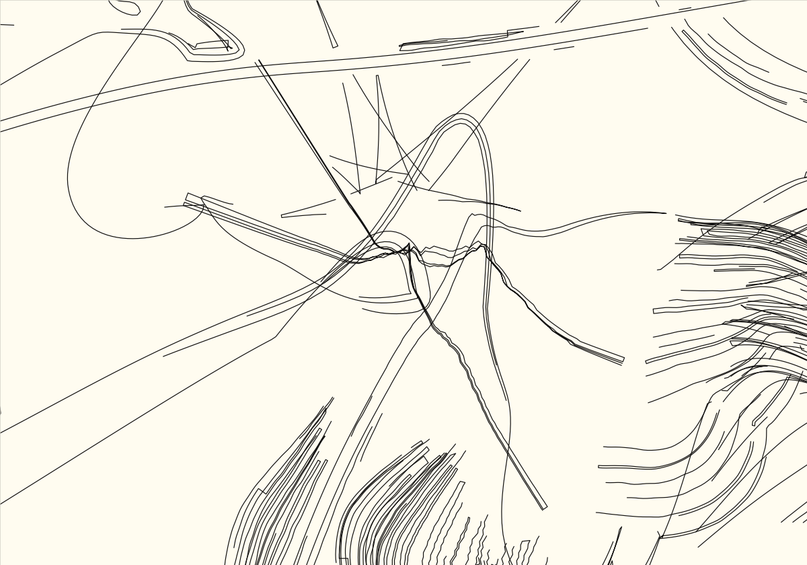
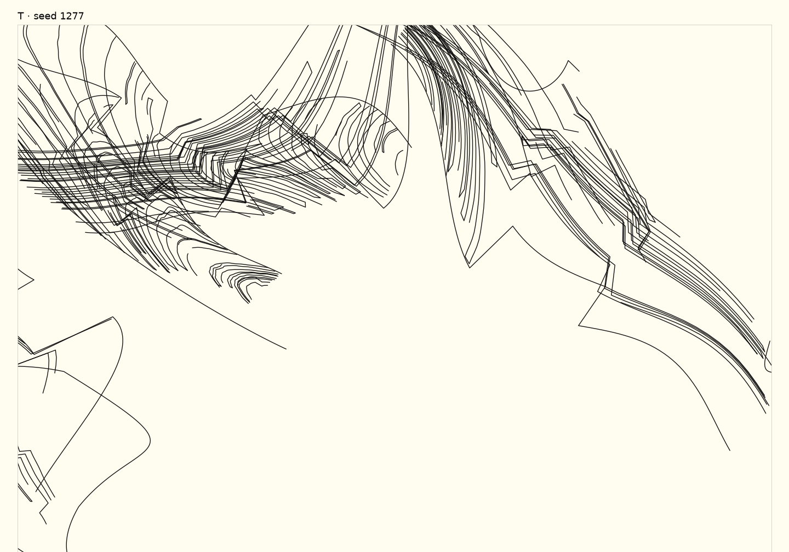

# Territory02 — a multidimensional brainstorm

5 October 2026. Proposals for discussion, not a new generator specification.
No aesthetic direction, convergence or implementation is selected here.

The opportunity is larger than making more curve shapes. A drawing can change
through its curves, connectivity, material, empty spaces, scale, overlaps,
history and the decisions made while looking at it. Our recent experiments
changed a few of these while leaving the others on repeat.

My current hunch: **we should explore different ways for a drawing to develop,
as well as different marks it can contain.** That is a hypothesis, not a reason
to abandon the user's direct request for tighter, more stylized curves.

## 1. What the evidence supports — and what it does not

Ian's constraints are clear: thin lines; more character in tightening, bulbs and
corners; intricate rough material with a convincing physical character;
occasional smoothness; substantial departures; no literal tracing of his
sketches; no recurring stock stars; no premature convergence. He liked the
rough three-material direction and rejected the later replacements as boring.
These preferences do not establish a desired amount of blank paper, a permanent
ban on repetition, or a requirement that every part be locally connected.

In the earlier material studies, long light routes and coarse banks have unequal
authority. A bank can interrupt following a line; the space between banks can
become a route of its own. The drawings also repeat obvious devices. We need not
choose between accepting all their habits and discarding their physical grain.

The new open constructions are visibly different but often repeat a relationship:
a faint route carries a little comb at a bend. The body trial sometimes offers
more, especially where grain directions overlap. Those exceptions matter, but
do not establish that the new population is more compelling. Likewise, the
older material's attraction may partly depend on density. We have not isolated
that from its other properties.

## 2. Ten dimensions we have been conflating

These are axes to reason with, not ten new sliders or ten compulsory virtues.
Some should remain stable while others change. Changing everything at once
makes another random generator; fixing everything makes another narrow style.

| Handle | Dimension | Different possibilities | A concrete question |
|---|---|---|---|
| A | **Curvature and gesture** | Long acceleration into a tiny turn; swollen outer curve with a pinched inner return; nearly straight span into a blunt corner; a confident curve abruptly abandoned. | Where does the bend concentrate, and what does that change elsewhere along the line? |
| B | **Connectivity** | Open strands; enclosed pockets; a route that changes partners at a crossing; shared boundaries; one line splitting into several and later leaving by another route. | Are we changing the drawing's connections, or merely bending the same connections? |
| C | **The role of a line** | Free gesture; edge of a mass; interior grain; seam; an apparent continuation across a gap. A single line could acquire different roles. | Can following a line change what we think we are following? |
| D | **Material behaviour** | Grain that accumulates, scrapes away, crosses itself, compacts, leaks beyond a boundary or survives as residue. Smooth and rough need not be separate fixed layers. | Does a fill have an interior life, or is it the same contour repeated sideways? |
| E | **Space and scale** | Large compressed encounter; small dense knot beside a huge plain passage; narrow channel opening into a chamber; activity partly beyond the frame. | Does the empty space have a particular shape, and are several scales doing different work? |
| F | **Relationships across the sheet** | Local contact; a near-miss; distant repetition with one changed property; opposed directions; shared omission; several independent objects. | Must these parts touch to matter to each other? |
| G | **Overlap and depth** | Visible crossing; interrupted crossing; one mass swallowing a line; a line appearing to continue behind material; flat coexistence with no depth cue. | What would hiding part of a route let the viewer infer? |
| H | **History** | One fluent pass; accumulated revisions; erased prior routes; an answer to an older state; interruption followed by an incomplete repair. | Could the drawing retain evidence of a decision that changed? |
| I | **Recognition and ambiguity** | Almost a letter, joint, tool, body, map or folded sheet, then a passage that prevents the reading from settling. Fully nonfigurative cases remain valid. | Does a partial association give us something to follow without becoming a stock icon? |
| J | **Authorship and selection** | One generator finishing a sheet; an agent editing a particular result; human-selected fragments; several incompatible continuations from one state. | Is the agent choosing what this drawing needs, or merely choosing parameters for its next sample? |

The reference paintings also open a **colour and value** question. Large colour
areas can assign unequal authority or conceal crossings. Translating that into
plotter work might use a second pen, paper colour, or packed thin strokes. None
is required for the current monochrome investigation. Colour should be tested
for what it changes structurally, rather than added as compensation for weak
geometry. Thin individual lines can coexist with locally dark accumulations.

## 3. “Tighter” contains several different requests

We should stop treating it as one curvature multiplier.

1. **A smaller turning radius:** the path really reverses within a shorter distance.
2. **A tighter gap:** two passages approach closely; neither needs extreme curvature.
3. **A squeezed neck:** a bulb has a narrow entry or exit, with unequal sides.
4. **Concentrated change:** most of a sweep is calm; its direction changes abruptly
   in a short section, possibly at an actual corner.
5. **A tighter relationship:** several marks become harder to separate perceptually,
   through shared edges, overlapping runs or selective occlusion.

These can disagree. A large generous bulb with one pinched exit can feel taut;
a page of small loops can feel loose and mannered. A hard corner has more force
when its neighbouring curves prepare a different expectation. Intricacy can come
from a route changing roles or partners, not only from adding smaller bends.

## 4. Repetition, coherence and variety need separate treatment

Repetition is not the whole problem. The earlier grain gains much of its material
character from repeated strokes. What fails is predictability at the wrong level:
the next bend receives the same bundle, the next seed gets the same relationship,
and the next intervention politely preserves the rest.

A stronger family might repeat the *physical behaviour* of a mark while varying
what the marks collectively become. Or repeat one strange shape but let its
meaning change when cropped, interrupted or placed at another scale. Conversely,
a sheet containing ten unrelated motifs can have broad vocabulary and little
worth following.

Coherence could come from shared direction, a dominant mass, a recurring interval,
one restricted material, a shaped void, or an accumulated history. It need not
come from uniform smoothness or making everything respond to nearby ink. We
should be able to name several candidate sources of coherence, then test whether
they are visible. A description alone does not establish them.

## 5. Six experiments that cross several dimensions

These are competing probes. They are not six filters to stack onto every seed.

### P1 — Let material establish the body

**Combines C, D, E and G.** Begin with a substantial irregular mass or two overlapping
masses. Remove and reopen parts of them; retain selected boundary stretches as
smooth curves. A line can enter as an independent sweep, disappear, then seem
to emerge as an edge. Grain may continue across the supposed edge elsewhere.

Imagine a coarse field whose missing interior becomes a bulb with a pinched
opening. The bulb is made partly by what is absent. This reverses the recent
habit of making a clean outline and placing tufts along it.

**Risk:** a textured blob with a decorative hole. **Evidence to seek:** moving
or removing the cavity changes how several surviving passages are read. Inspect
the uncarved version beside it; do not praise the carving merely because it occurred.

### P2 — Change the partners, then redraw the joins

**Combines A, B and C.** Start with actual curves from a promising drawing. Cut
selected intervals and reconnect different continuations. Some stretches become
shared boundaries; others remain unresolved. Redraw enough of the joining path
to create a sharp return, bulb or long unequal sweep. There is no requirement to
preserve the old endpoints, number of courses or route identities.

A broad curve might enter a rough bundle and leave through a strand that previously
belonged to another shape. The resulting enclosure could be impossible to get
from merely displacing the original curve.

**Risk:** clever knots or spaghetti. **Evidence to seek:** compare the same marks
with original and exchanged continuations. Connectivity must make a perceptible
difference; the operation's name is irrelevant.

### P3 — Give two incompatible constructions unequal authority

**Combines D, E, F and G.** One construction can be broad, slow and smooth; another
compressed, grainy and angular. They need not share local rules or fill each
other. Test crossing, near-missing and partial concealment, with unequal scales.
A small contact might organize a much larger interval elsewhere.

This could be a large interrupted enclosure partly displaced from a dense rough
body, with one shared edge and several disagreements. The shared edge is one
possibility, not a mandatory compositional trick.

**Risk:** two unrelated layers or tasteful collage. **Evidence to seek:** translate
one construction a substantial distance while leaving it otherwise unchanged.
Does the original relation lose anything specific? A successful near-miss is as
legitimate as a physically simulated contact.

### P4 — Develop a drawing through revision

**Combines B, G, H and J.** Let a first pass make a forceful proposal. A second pass
can remove, overwrite, crop, reroute or answer an earlier state. Leave enough of
the abandoned proposal to create uncertain continuities. Sometimes stop before
repairing the interruption.

This gives the smooth passages a possible temporal role: a later deliberate
sweep can contradict rough earlier work, or rough material can interrupt an
overconfident smooth construction. Neither order should become permanent.

**Risk:** fake distressed surfaces. **Evidence to seek:** inspect the sequence,
including the stage before the final pass. The final image may be worse. An
interesting history is not proof of an interesting drawing.

### P5 — Compose with fragments that retain their internal character

**Combines E, F, H and J.** Take irregular fragments from the stronger material
studies, including awkward cuts and incomplete edges. Change their scale,
orientation, overlap and neighbours, while preserving their fine structure as
much as the physical medium allows. Allow a new curve only where it changes the
reading of the assembly; empty gaps can remain unbridged.

This treats the bench as a source of material for authorship. It may be a better
route to good drawings than insisting each generator produce a complete sheet.

**Risk:** a reusable sticker library with recurring silhouettes. **Evidence to
seek:** use the same fragments in genuinely different assemblies; compare those
with replacing all fragments while keeping the arrangement. This separates the
interest of the parts from the interest of their relationships.

### P6 — Study curve character under several kinds of constraint

**Combines A, E and I.** Keep the direct curve request alive. Take one long route
and redraw it several ways: a swollen shoulder entering a slit; an off-centre
return; a curve almost flattened by an adjacent boundary; an unresolved sharp
turn. Work with both the curve and the shape of the neighbouring gap.

The same curve should then be seen alone, against a coarse body, and partly
hidden. The curve that wins in isolation may be too self-contained in a drawing.

**Risk:** another signature hook. **Evidence to seek:** vary where the concentration
occurs and what the curve is asked to meet. Do not put a bulb/corner quota into
every output. This probe is a component study, not a full artistic solution.

## 6. Some combinations worth arguing about

| Combination | Why it might matter | What could make it dull |
|---|---|---|
| P1 + P6 | A carved material body sets a difficult negative space; a deliberately redrawn curve can intensify it. | Smooth outline tidies the material into a logo. |
| P2 + P4 | Reconnecting routes leaves residues of the previous drawing; topology and history both change. | Every image becomes a knot with ghost lines. |
| P3 + P5 | Independent rough fragments and a smooth construction can relate at sheet scale without sharing a generator. | Composition becomes a fixed large-shape/small-accent recipe. |
| P4 + P6 | A precise later curve contradicts an earlier drawing while retaining some evidence of it. | The same elegant flourish is always added at the end. |

These combinations stay hypothetical until their separate evidence is useful.
The multidimensional space is a way to keep options open, not a justification
for converging all mechanisms.

## 7. Change the agent loop as well as the generator

The previous loop encouraged small named mechanisms, strict preservation and
long explanations of local effects. Independent reviewers could find a passage
to discuss even when the overall result did not meet Ian's request. Our reports
sometimes gave that interpretability too much credit.

A different loop could work on **particular drawings**, not immediately on reusable
styles. Give makers the same few starting states with permission to transform
most of the sheet. Give each a different restriction, not a required motif:
one begins with material; one changes connections and omissions; one composes
independent constructions. They can stop, erase or abandon an intervention.
Only after there are compelling examples should we ask what can generalize.

Keep two kinds of experiment distinct. Free proposals allow several dimensions
to change together and test artistic possibility. Controlled edits answer a
narrow causal question. A controlled edit can be excellent evidence and a boring
drawing. A compelling free proposal can be worth keeping even when we cannot
attribute its interest to one operation yet.

For the review:

1. Show whole sheets before revealing mechanisms. Let a reviewer say none merits
   development; do not require a positive feature for each family.
2. Include an untouched earlier drawing and a previous weak result anonymously.
   This can expose whether a new title is doing the persuasive work.
3. Then inspect close views, line/material omissions and histories. A crop must
   not silently become evidence for the whole sheet.
4. Ask which relationships recur across the population, not just whether the
   silhouettes differ. Leave uncertain judgements uncertain.
5. Keep the thin physical stroke. Compare at enough resolution to see it, and
   separately assess whether accumulated ink has the intended weight on paper.
6. Show Ian a small contact sheet before investing in a full gallery and report.
   Do not turn every new probe into another supposedly finished direction.

### What the representation would need to allow

Each probe implies different editable state. Material-first work benefits from
regions, holes and boundaries whose identities survive an edit. Reconnecting
paths needs explicit connections and gaps, so changing partners is possible
without hiding the operation inside a deformation. Independent composition
needs movable groups that retain their internal grain. Revision needs a sequence
with branches and partially retained earlier states.

Those are alternative small representations to test. Building a universal engine
for all of them now would be premature. At present, an array of finished strokes
makes it easy to move coordinates and difficult to make decisions about what a
boundary, opening or continuation is. Our approximate ownership heuristics are
one symptom of that limit.

The agent could also act first as an editor of actual geometry: inspect a sheet,
choose a region, propose several concrete edits, and compare their consequences.
Human choices would build an archive of preferred relationships and useful
failures. General rules could be extracted from that archive later. More agents
sampling the same narrow constructor will not by itself broaden what that
constructor can express.

## 8. A second eye challenges the diagnosis

A bounded Sol reader inspected the earlier pressure/unravelling populations,
the 587 material close comparison, new open development sheets and new body
fresh sheets. It knew the context; this was not a blind review or an independent
brainstorm design. It challenged three assumptions rather than inventing a
replacement instrument.

It read pressure/unravelling 5 through changing authority among broad loops,
hairlike fields and brittle crossings. It also found useful nonlocal relations
in new open 24 and body 1213: a compressed dark elbow can affect how a distant
pale contour and their intervening blank are followed. It found opening 587
and parts of new open 47 weaker, where accents decorate a gap without changing
much else. These are readings of appearance, not proof of a causal mechanism.

This qualifies my previous claim that the new work is boring. I still find its
population too restricted, but I should not turn Ian's rejection into a rule
that sparse or cleaner work is inherently inert. The reader's counterexamples
support testing relationships across space as a separate dimension. They do
not override Ian's judgement or promote a new favourite.

## 9. My present position

I would first argue for **P1, P2 and P3 as genuinely different starting questions**:
material establishes form; connectivity changes form; independent constructions
create relationships across space. P4 concerns how any of them develops over
time. P5 questions whether a complete-sheet generator is the right instrument.
P6 protects the original demand for stronger curves from getting lost in theory.

That is a proposed exploration map, not a selection. The unresolved priorities
include how much density to retain, how strongly smooth passages should dominate,
and whether the next output should be a complete sheet or useful material for
further composition. Those choices belong in the discussion after this brainstorm.
