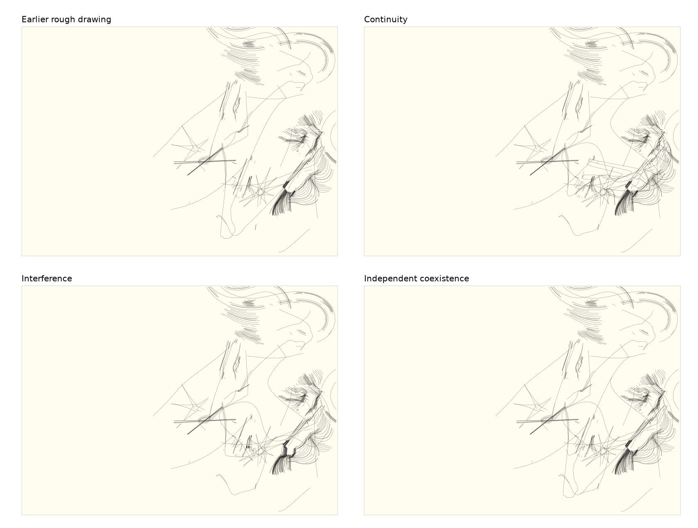

# Territory02 — rough and smooth coexistence

5 October 2026. Screen study, in the existing `codex/territory02` worktree.

[Comparison](../../tools/territory02/takeover/coexist/index.html) ·
[Construction and reproduction](../../tools/territory02/takeover/coexist/NOTES.md) ·
[Independent Sol reading](territory02-coexist-sol.md)

The three relationships are now visible beside the actual earlier rough drawing
and the new smooth passages alone. Continuity makes the strongest disturbances,
sometimes producing awkward stretched bridges. Interference is often subtle.
Independent coexistence preserves the contrast most literally, but its new
curves can look superimposed. These are separate propositions for Ian to inspect;
no winner, combined generator or production default has been selected.

## What this responds to

Ian liked the rough three-material experiments, sometimes more than the smoother
grammar probe. The latest hand drawing suggests broad sweeps, swollen returns,
tight necks and concentrated corners, with different kinds of line sharing a
sheet. It is a qualitative reference: no points, colours or contours were traced.
The rough opening, pressure and unravelling results remain the foundation,
including their inherited oddities. Their material was not regenerated using a
cleaner recipe. All drawings retain a thin 0.1 mm physical stroke.

Two substantial smooth paths are constructed in relation to actual surviving
rough strokes. The construction uses unequal Bézier handles, large unequal
excursions and an abrupt tangent change. It remains a bounded four-segment
vocabulary. The smooth-only populations expose a remaining habit of curled,
open lobes and pointed returns; this round does not establish an unrestricted
new grammar. On dense sheets, the new paths can also become hard to distinguish
at whole-sheet scale.

## What changes, and what remains unresolved

**Continuity** exchanges part of an actual rough stroke for a smooth passage;
a few nearby existing fragments partially follow it. At 24/unravelling, an angular
ribbon crosses the pale belly. This is an interesting incompatible texture,
but it can also resemble a stretched diagram imposed on the drawing. Fresh
1009/opening develops an unusually dense angular weave at the upper right of
the altered passage. That intervention has more consequence than a decorative
smooth overlay, but greater consequence alone does not make it coherent.

**Interference** exchanges the source interval, then moves the smooth path and
nearby short grain at measured dense contacts. Its local exchanges leave more of
the earlier drawing intact. Some differences disappear at sheet scale; the
1009/pressure close view makes the meeting of the broad return and angular grain
legible, but does not prove a convincing mutual response everywhere.
13/opening has no qualifying contact and 24/opening only one. These quiet cases
remain in the population rather than being supplemented with a stock flourish.

**Independent coexistence** adds the smooth paths while preserving every rough
stroke exactly. Original and new routes can enclose an unfamiliar space. Fresh
1061/unravelling has a rounded hanging shape among interrupted fan-like lines;
the curve can be read both as an enclosure and as a crossing. This keeps the
rough material's autonomy. Elsewhere it risks adding another contour without
changing how the material is read. It is also a different intervention from the
other two: its original source intervals remain present.

Material ownership in the interacting trials is inferred from earlier stroke
ordering or short-run geometry. These are real surviving base strokes, but not
an exact semantic fill layer. Some displaced bare fragments can qualify and
some long material strokes are excluded. A future implementation should not
mistake this prototype heuristic for reliable provenance.

## Evidence and limits

Development seeds 13/24 and fresh seeds 1009/1061 each run on three rough bases.
That is twelve base cases and sixty final drawings, including both controls.
The fresh population contains two independent seeds, not six: the bases share
underlying drawings. Generator sources and dependencies were hash-frozen before
the fresh seeds were generated. No geometry tuning followed their inspection.

Repeatability, unchanged input hashes, finite coordinates, bed bounds, stroke
budgets and optional stage geometry passed. Independent coexistence's rough
prefix is exact. Largest output is 69,558 points; longest is about 32.81 m,
below the study's 250k-point/100 m ceilings. These are mechanical checks.

The gallery passed 120 image states at desktop/mobile sizes using its own
SVG/CSS embedded at `about:blank`, with no external requests. Actual in-app file
navigation and link opening remain unverified after the earlier security block.
Whole sheets and matched 100×70 mm close views were inspected; the fixed close
can miss the second smooth path or a material contact. Nothing was plotted.

## Independent critique

The bounded Sol reviewer saw neutral calibration D/E/F and all ten neutral
population sheets before learning their construction, plus selected close views.
Its initial reading valued the central unsupported gap in the source-exchanged
calibration as much as the more consequential additions. Across the population,
it found continuity's angular interruptions worth protecting, while questioning
whether repeated ribbons explained the same point twice. It also found a useful
near-miss in independent coexistence's 1061 close view.

I retain a more skeptical reading of the stretched bridges: their visible
consequence can still look mechanically imposed. Conversely, the review's
attention to an unsupported gap argues against treating every quiet interference
case as a failure. Its proposed follow-up is especially useful: hold the field
constant and place one rough passage crossing, touching and narrowly missing
the same smooth boundary. That would separate the effect of contact from the
effect of proximity. The complete review preserves initial readings and any
later attribution corrections; it is evidence, not automatic acceptance.

After the reveal, the reviewer separated the useful appearance of W/independent's
near-miss from a claim of causal response: the rough base is unchanged. I agree
with that distinction while retaining proximity as a legitimate aesthetic
relationship. It corrected one close-view attribution from N·1009·b/c to
N·1009·a; the original reading and explicit correction remain in its report.

## Possible next relationships — not selected

- Start from independent coexistence and allow only one local exchange where
  a smooth passage meets rough material. This could preserve the rough base's
  autonomy without leaving every meeting incidental.
- Keep continuity's angular bridges as occasional ruptures, with long smooth
  stretches before and after them. Their rarity would need testing; applying
  the same bridge everywhere would create another obvious repeated device.
- Let a rough fragment change the *kind* of smooth continuation: an open arc
  could split, stall, double back or end. That would change the current fixed
  path construction more deeply than increasing displacement.

These are proposals for discussion after Ian sees the results. The three current
trials and their weak cases remain available without a merged style.
