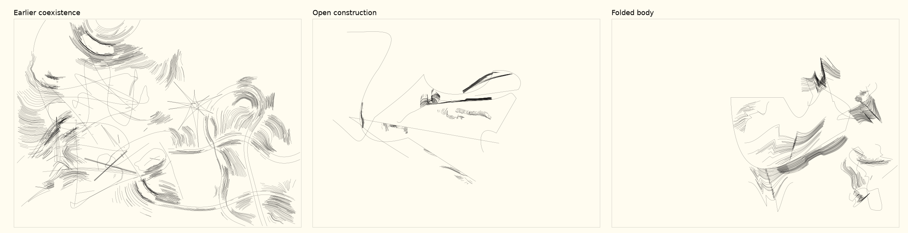

# Territory02 — replacing the scaffold

5 October 2026 · screen experiment · no convergence selected.

[Gallery](../../tools/territory02/takeover/rupture/index.html) ·
[Source notes](../../tools/territory02/takeover/rupture/NOTES.md) ·
[Independent review](territory02-rupture-sol.md)

Ian rejected the coexistence round as barely changed, still starry and repeating
the same shapes. The primary had preserved so much of the earlier drawing that
local revisions could not deliver the requested departure. The earlier report
now records that rejection; its positive machine readings are not acceptance.

This experiment replaces every main path. Only cropped pieces of actual grown
grain survive. Old base courses, radial thorn/surprise, slash/chord, wedge and
continuation layers are excluded from the new output. Open constructions and
folded bodies remain separate trials alongside the rejected earlier result.

## Visible changes and remaining habits

The replacement is apparent at whole-sheet scale. Open constructions distributes
thin long passages and small rough patches across larger gaps. Folded bodies
allows broader enclosures, incomplete boundaries, overlapping material and
stronger angular changes. Different path counts, lengths, reversals and closures
replace the fixed few smooth additions of the previous round. The two trials
use different random streams: their comparison does not isolate material alone.

P/1213 is a useful open case: a long shelf-like line, a raised curved blade and
a detached row of fragments compete for the central space. P/1277 is much less
active; its scattered light contours and lower cluster do not sustain the same
reading. Keeping that weak case matters more than presenting only P/1213.

T/47 has a large irregular enclosure with a small rounded protrusion and a
separate rough thicket to its right. The interval between them feels particular.
T/1277 has overlapping grain directions and a transition between a mesh,
angular repeated bends and a long escaping curve. T/24 is weaker: most material
collects at one end while the broad contour does little in return. T/1151 retains
an unresolved possibility of detached grain reading as garnish.

The texture still has a recognisable stepped, comb-like dialect. Removing the
explicit stars does not by itself solve recurrence. Some inherited grain can
still converge into pointed clusters, and repeated cropped fragments can become
a new ornament habit. This is a visibly different scaffold with unresolved
material vocabulary, not a claim that the generator is now artistically solved.

## Revision and independent reading

The first development probe wrapped patches along the moving normal of a path.
Around sharp corners, that collapsed many fibers into fans and recreated a
star-like effect. The retained `probe-v1.png` and source show this failure. The
current finite chord frame avoids that collapse, while retaining limited bend,
shear and unequal patch width. It can also make a patch feel pasted beside a
line; the trade-off remains visible.

A Sol second eye first compared neutral full/lines/material omission controls,
then six neutral development/fresh population sheets with whole and close views.
It described P as a clear distributional departure whose local material relation
still often repeats. It read T as farther from K, especially where bundles cross
or redirect one another. Its preference for T/1277's incompatible grain is useful;
I remain cautious that a mesh can become just another default. The reviewer also
found the isolated lines in the calibration weaker than the combined drawing.
That warns against equating deleting inherited devices with sufficient interest.

## Evidence and next decisions

Development seeds: 13, 24, 47. Fresh seeds: 1151, 1213, 1277. Twenty source and
dependency hashes were frozen before fresh generation and remain unchanged.
No tuning followed the fresh population. There are twelve new drawings and six
earlier references, with separate new lines/material checks. Repeatability,
finite coordinates, bed bounds and geometry ceilings passed. New results range
from about 3.2 to 13.9 m of line, at most 15,772 points. Reduced ink is part of
the visible departure; the comparisons do not match total material density.

Seventy-two gallery image states passed at desktop/mobile sizes using only
in-memory own SVG/CSS at about:blank. Actual local-file navigation, paper and
human interaction remain unverified. All strokes remain 0.1 mm. The fixed
central close can omit the active passage, especially P/1277 and T/24.

For a next discussion, the useful fork is whether to develop the broad body/
fragment relations or replace more of the remaining comb-like grain itself.
Either can be explored without combining these trials into one style. Ian's
judgement of the visible results comes first; no further convergence is selected.
